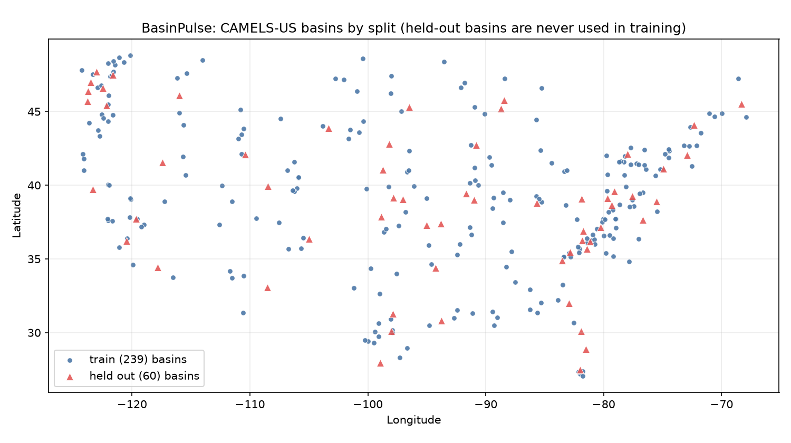

# Split summary (BASINSHIFT 7.3)

Generated by `scripts/caravan/split_summary.py`. 299 CAMELS-US basins: 239 used for training, 60 held out
entirely (no training rows), sampled in proportion to 14 USGS regions.

## Catchment characteristics: median (10th – 90th percentile)
The KS column is the Kolmogorov-Smirnov distance between the two distributions (0 = identical; with
60 vs 239 basins, values below ~0.2 are consistent with the same distribution).

| Characteristic | Train basins | Held-out basins | KS |
|---|---|---|---|
| Area (km²) | 330 (40 – 1,933) | 391 (125 – 1,946) | 0.17 |
| Aridity (PET/P) | 0.79 (0.49 – 1.66) | 0.79 (0.43 – 1.53) | 0.11 |
| Mean precipitation (mm/day) | 3.08 (1.57 – 4.12) | 3.06 (1.68 – 4.29) | 0.07 |
| Snow fraction of precipitation | 0.09 (0.00 – 0.51) | 0.07 (0.00 – 0.26) | 0.13 |
| High-precipitation day frequency | 0.054 (0.038 – 0.061) | 0.053 (0.042 – 0.062) | 0.07 |
| Mean elevation (m) | 532 (122 – 2,153) | 468 (96 – 1,549) | 0.07 |
| Mean slope (0.1°) | 56 (7 – 176) | 64 (5 – 137) | 0.10 |
| Forest cover (%) | 90 (2 – 100) | 88 (2 – 100) | 0.09 |
| Degree of regulation (%) | 0.0 (0.0 – 5.8) | 0.0 (0.0 – 0.0) | 0.08 |
| High-flow threshold q95 (mm/day) | 4.06 (0.44 – 11.09) | 3.37 (0.46 – 14.40) | 0.15 |

Training record per train basin: median 27.0 years of observed flow (1981-10 to 2008-09).

## Basins per USGS region (first two digits of the gauge number)
| Region | Train | Held out |
|---|---|---|
| 01 | 34 | 9 |
| 02 | 36 | 8 |
| 03 | 22 | 6 |
| 04 | 11 | 3 |
| 05 | 15 | 4 |
| 06 | 23 | 6 |
| 07 | 14 | 4 |
| 08 | 18 | 4 |
| 09 | 12 | 3 |
| 10 | 7 | 2 |
| 11 | 14 | 3 |
| 12 | 16 | 4 |
| 13 | 6 | 1 |
| 14 | 11 | 3 |

Map: 
